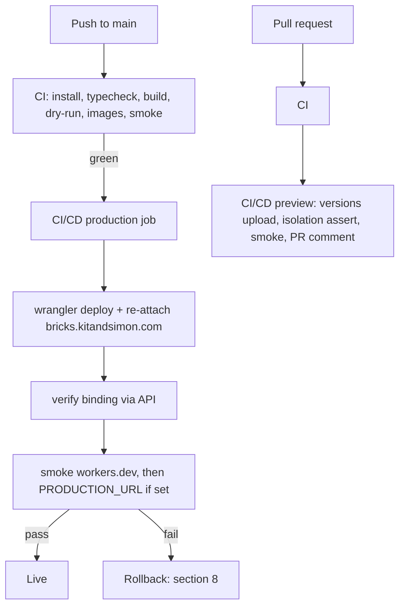
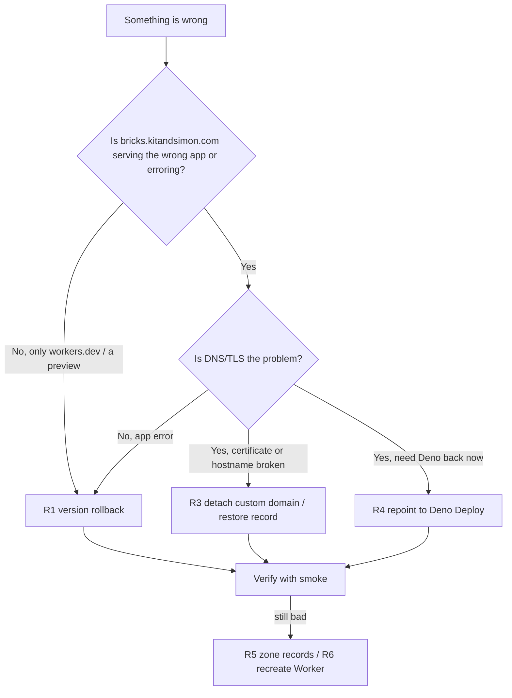

# CI/CD, cutover and rollback runbook

Operational runbook for the Bayside Bricks deployment: what credentials exist,
how the Worker and its domain are configured, how the site was cut over from
Deno Deploy to Cloudflare Workers, how to verify a deployment, and how to roll
back safely.

Written so that an operator who has never touched this stack can execute the
cutover or a rollback from this page alone. Design rationale and the as-built
history live in [`web/docs/deploy.md`](../web/docs/deploy.md); this document is
the *do this now* half.

- App: `web/` (Astro 7 SSR, `@astrojs/cloudflare`)
- Pipelines: [`.github/workflows/ci.yml`](../.github/workflows/ci.yml) (verify),
  [`.github/workflows/ci-cd.yml`](../.github/workflows/ci-cd.yml) (preview + production)
- Last verified against production: 2026-11-13, commit `2b85425`
  (deployment `bf24917a-d78d-4bbf-a4c4-d42b8e3ec9db`, version `48480db8`)



## 1. Owners and access

| Area | Owner | What they need | Where the credential lives |
| --- | --- | --- | --- |
| Repository, Actions secrets and variables, workflow disable | Kitson Kelly | admin on `kitsonk/bayside-bricks` | `gh` CLI already authenticated as `kitsonk` |
| Cloudflare account (Worker, zone, custom domain) | Kitson Kelly | Super Administrator, or a scoped API token (§3.2) | `wrangler login` OAuth session on the operator's machine; 1Password item **Cloudflare** for the dashboard (password + TOTP) |
| Registrar `kitandsimon.com` (GoDaddy) | Kitson Kelly | domain ownership; API key for scripted changes | 1Password item **Godaddy**, field `API Key and secret` (key and secret on two lines — §6 step 5) |
| BrickLink storefront, embed sign-off, business acceptance | Simon | BrickLink store admin | — |
| Deno Deploy project `kitsonkelly/bricks` (legacy, live fallback) | Kitson Kelly | Deno Deploy dashboard access | **not stored locally** — see §8.4 |

Rules of engagement:

- Two people minimum for a cutover: one executes, one verifies. Neither may be
  the only person with registrar access at the moment of the change.
- Do not run the cutover outside a change window agreed with Simon; the
  storefront iframe is the shop window.
- Never paste the API token into a ticket, a commit, or this document. It is
  write-only in GitHub and cannot be read back (§3.3).

## 2. Inventory

| Thing | Value |
| --- | --- |
| Repository | `kitsonk/bayside-bricks` (public), default branch `main` |
| Cloudflare account | `6d3c3bec6c29c262b87b782e7a7b12de` — *Kitson Kelly Personal Account* |
| Worker | `bayside-bricks` |
| Worker URL (pre-cutover and permanent rollback surface) | `https://bayside-bricks.me-6d3.workers.dev` |
| Preview URL shape | `https://<first 8 of version id>-bayside-bricks.me-6d3.workers.dev` |
| Custom domain | `bricks.kitandsimon.com` → `bayside-bricks` (binding id `775a47a88ca22a8dca76bbb4151c53d53ba62e8c`) |
| Zone | `kitandsimon.com`, id `21ae6e9bd7b4c714c1861b7b65df76ce` |
| Zone nameservers | `danica.ns.cloudflare.com`, `vicente.ns.cloudflare.com` |
| Registrar | GoDaddy, status `ACTIVE`, delegating to the pair above |
| Workflows | `CI` (`ci.yml`, id 416806081), `CI/CD` (`ci-cd.yml`, id 411649003) |
| GitHub environment | `Production` (used by the production job; no protection rules today) |
| Legacy hosting | Deno Deploy project `kitsonkelly/bricks`, live at `https://bricks.kitsonkelly.deno.net` (the Fresh app at the repo root). The `deployctl` workflow was retired in `07a9b3e`, but Deno's own GitHub integration still builds that app on every push to `main` (check run `deploy/kitsonkelly/bricks`), so the fallback stays warm |

Set these for every command block below:

```bash
export CLOUDFLARE_ACCOUNT_ID=6d3c3bec6c29c262b87b782e7a7b12de
export CLOUDFLARE_ZONE_ID=21ae6e9bd7b4c714c1861b7b65df76ce
export CF_DOMAIN_ID=775a47a88ca22a8dca76bbb4151c53d53ba62e8c
export CLOUDFLARE_API_TOKEN=...      # §3.3 — never committed
```

## 3. Secrets and variables

### 3.1 Complete list (verified 2026-11-13)

GitHub repository secrets — the only stored secrets in the system:

| Name | Value | Used by | Notes |
| --- | --- | --- | --- |
| `CLOUDFLARE_API_TOKEN` | scoped API token (§3.2) | both deploy jobs: preview uploads a version and toggles Preview URLs; production deploys and attaches the custom domain | Never the Global API Key, never the wrangler OAuth token |
| `CLOUDFLARE_ACCOUNT_ID` | `6d3c3bec6c29c262b87b782e7a7b12de` | both deploy jobs | Not actually secret, stored as one so the workflow has a single source |

Everything else, so that "is the list complete?" has an auditable answer:

| Item | Status |
| --- | --- |
| GitHub repository variables | none set. `PRODUCTION_URL` is optional and currently unset (§3.4) |
| GitHub environment `Production` secrets/variables | none — the environment only groups the production job |
| Worker secrets (`wrangler secret list --name bayside-bricks`) | `[]` — the app requires none |
| Local dev secrets | none. `web/.dev.vars` (gitignored) holds only `APP_ENV=development`; `web/.dev.vars.example` is the committed template |
| `GITHUB_TOKEN` | automatic per-run; needs only `contents: read` + `pull-requests: write` for the sticky preview comment |

The application itself has no runtime secrets: `web/src/lib/env.ts` reads plain
variables, and the environment matrix (`.dev.vars.example`) records "no secrets,
one non-secret variable". If that ever changes, add the variable here **and** to
§6's checklist.

### 3.2 `CLOUDFLARE_API_TOKEN` permissions

Create at *dash.cloudflare.com → My Profile → API Tokens → Create Custom Token*.
Zone resources: *All zones from an account → Kitson Kelly Personal Account*.

| Scope | Permission | Needed for |
| --- | --- | --- |
| Account | **Workers Scripts: Edit** | `wrangler deploy`, `wrangler versions upload`, `wrangler rollback`, enabling Preview URLs |
| Account | **Account Settings: Read** | account lookup during deploy |
| Zone | **Workers Routes: Edit** | attaching `bricks.kitandsimon.com` to the Worker |
| Zone | **Zone: Read** | resolving the zone and reporting activation status |
| Zone | **DNS: Edit** | cutover and DNS rollback only (§6, §8.4) |

Minimum for routine deploys: the first four. Add **DNS: Edit** before a cutover
or a DNS rollback; drop it afterwards. This matters in practice — the wrangler
OAuth session on this machine has `workers_routes` and `zone` read but **no DNS
permission** (`GET /zones/{id}/dns_records` returns 403), so DNS work needs
either this token or the dashboard.

No KV, R2, D1, Pages, SSL or Access permissions are required.

### 3.3 Set, rotate and verify

```bash
# set (paste the token at the prompt; it is never echoed)
gh secret set CLOUDFLARE_API_TOKEN --repo kitsonk/bayside-bricks
gh secret set CLOUDFLARE_ACCOUNT_ID --repo kitsonk/bayside-bricks \
  --body 6d3c3bec6c29c262b87b782e7a7b12de

# what exists (names and dates only, never values)
gh secret list --repo kitsonk/bayside-bricks
gh variable list --repo kitsonk/bayside-bricks

# prove a token works before trusting it in CI
CLOUDFLARE_API_TOKEN=... npx wrangler whoami     # prints the token's own permissions
```

Rotate by creating a new token, setting it, then running the production job once
(`gh workflow run "CI/CD" --repo kitsonk/bayside-bricks`) and deleting the old
token in the dashboard. **Secrets cannot be read back** — if the current token is
lost, create a new one; do not attempt to recover it.

### 3.4 Optional variable `PRODUCTION_URL`

The production job smokes `PRODUCTION_URL` in addition to the workers.dev host,
and the preview job treats it as a production hostname it must not match. Set it
to the custom domain now that the cutover is done:

```bash
gh variable set PRODUCTION_URL --repo kitsonk/bayside-bricks \
  --body https://bricks.kitandsimon.com
```

Set on 2026-11-13 at `04:47Z`, once the zone was active and the Worker had been
serving the custom domain since `04:22Z`. Before that the post-deploy smoke only
proved the workers.dev host, which is the same build but not the public hostname.
Set it as the last step of a cutover (§6, step 8) — not before, or a deploy
during the flip proves the wrong site. Nothing about the cutover is outstanding.

### 3.5 Kill switch

Deleting the secrets makes both deploy jobs skip with a warning while `CI` keeps
running; that is the fastest way to stop deploys that survives workflow edits:

```bash
gh secret delete CLOUDFLARE_API_TOKEN --repo kitsonk/bayside-bricks
gh secret delete CLOUDFLARE_ACCOUNT_ID --repo kitsonk/bayside-bricks
```

## 4. Worker and domain configuration

`web/wrangler.jsonc` is the base config; at build time the adapter writes a
resolved copy to `dist/server/wrangler.json`, and that is what every
`wrangler dev` / `wrangler deploy` / CI job uses.

| Key | Value | Why it matters |
| --- | --- | --- |
| `name` | `bayside-bricks` | Worker identity; all commands address it by name |
| `compatibility_date` | `2026-11-03` | pinned, must stay within the bundled workerd's range; bump deliberately |
| `compatibility_flags` | `["nodejs_compat"]` | `src/lib/env.ts` reads bindings via `process.env` |
| `workers_dev` | `true` | keeps `bayside-bricks.me-6d3.workers.dev` alive: the pre-cutover production host and the permanent rollback surface |
| `preview_urls` | `true` | without it `wrangler versions upload` prints no preview URL and PR previews break |
| `routes` | `[{ "pattern": "bricks.kitandsimon.com", "custom_domain": true }]` | `wrangler deploy` attaches the hostname, creates the proxied record and the certificate request; no dashboard step |
| `observability` | enabled | Workers Logs |

Two load-bearing details, both learned from real failures:

- **Declaring `routes` disables workers.dev by default.** With `workers_dev`
  omitted, the first custom-domain deploy removed the only host serving the site
  pre-cutover and the job had nothing to smoke. Keep both keys explicit.
- **Preview URLs are a separate per-Worker switch.** A production deploy turned
  it off once, silently. The preview job now re-asserts it on every run.

Verify the binding after any deploy:

```bash
curl -sS -H "Authorization: Bearer $CLOUDFLARE_API_TOKEN" \
  "https://api.cloudflare.com/client/v4/accounts/$CLOUDFLARE_ACCOUNT_ID/workers/domains?per_page=50" \
  | jq -r '.result[] | select(.hostname=="bricks.kitandsimon.com")
           | "\(.hostname) -> \(.service)  id=\(.id)"'
# bricks.kitandsimon.com -> bayside-bricks  id=775a47a8...
```

Zone contents (12 records, rebuilt 2026-11-13; the count needs a DNS-capable
token — see §9): five Google Workspace MX, SPF
TXT, apex `A 160.153.0.160` (the legacy WordPress blog, proxied), `www` CNAME to
the apex, four Google Workspace CNAMEs (`mail`, `calendar`, `drive`, `groups`)
and the `bricks` record managed by the custom-domain binding. **Only `bricks`
belongs to this migration.** Apex, `www` and mail are out of scope; a rollback
must not touch them.

## 5. Pre-cutover checklist

Complete every line, in order, and record the evidence in the change ticket. Do
not start the cutover with an unchecked box.

| # | Check | Command | Expected |
| --- | --- | --- | --- |
| 1 | `CI` green on the target commit | `gh run list --workflow CI --repo kitsonk/bayside-bricks --limit 5` | `success` on `main` |
| 2 | `CI/CD` production job green on the same commit | `gh run list --workflow CI/CD --repo kitsonk/bayside-bricks --limit 5` | `success`, production step included |
| 3 | Worker answers on workers.dev | `curl -sS -o /dev/null -w '%{http_code}\n' https://bayside-bricks.me-6d3.workers.dev/` | `200` |
| 4 | Full smoke suite passes on the Worker | `cd web && node scripts/smoke.mjs https://bayside-bricks.me-6d3.workers.dev --images` | `21/21 checks passed, 1 skipped` |
| 5 | Zone exists and nameservers are assigned | `curl -sS -H "Authorization: Bearer $CLOUDFLARE_API_TOKEN" "https://api.cloudflare.com/client/v4/zones/$CLOUDFLARE_ZONE_ID" \| jq '.result \| {status, name_servers}'` | `pending`, `danica`/`vicente` (or `active` if already cut over) |
| 6 | Zone records complete (12) | Cloudflare dashboard → `kitandsimon.com` → DNS, or §4 | MX ×5, SPF, apex A, www, 4 Google CNAMEs, `bricks` |
| 7 | Custom domain bound to the Worker | §4 verify snippet | `bricks.kitandsimon.com -> bayside-bricks` |
| 8 | Registrar access works **before** it is needed | the read-only `sso-key` block in §6 step 5 | `ACTIVE` plus `danica`/`vicente` |
| 9 | Rollback target identified | `cd web && npx wrangler deployments list --name bayside-bricks` | previous good deployment + version id noted in the ticket |
| 10 | Deno Deploy fallback confirmed, or its loss accepted | `curl -sS https://bricks.kitsonkelly.deno.net/ -o /dev/null -w '%{http_code}\n'` | `200` — the legacy Fresh app; see §8.4 if not |
| 11 | `PRODUCTION_URL` decision made | `gh variable list --repo kitsonk/bayside-bricks` | unset before cutover; set as step 8 |
| 12 | Simon briefed, change window agreed | — | written confirmation |
| 13 | `CLOUDFLARE_API_TOKEN` has **DNS: Edit** for the window | `CLOUDFLARE_API_TOKEN=... npx wrangler whoami` | permission listed |

If any of 1–7 fails, stop: the cutover is not the problem, the deployment is.

## 6. Cutover procedure (Deno Deploy → Worker)

The nameserver flip at the registrar is the only step that changes where
`bricks.kitandsimon.com` resolves. Everything on the Cloudflare side is already
declared in `wrangler.jsonc`, so there is no dashboard work and nothing to hand
edit — the point of the design is that the binding cannot drift.

**Current state (2026-11-13): complete.** The zone activated at `04:15:46Z`
(GoDaddy moved from `alice`/`bob` to `danica`/`vicente`), production has been
served by the Worker since the `04:22:26Z` deployment, and step 8
(`PRODUCTION_URL`) was set at `04:47Z`. Keep this section for a re-cutover after
a rollback, or to verify what was done.

### Step 0 — freeze and announce

Announce the window, agree who verifies, and stop merges to `main` for the
duration (no branch protection is enforced today, so this is social, not
technical — see §9).

### Step 1 — confirm the Worker is the thing you are cutting over to

```bash
cd web
npx wrangler deployments status --name bayside-bricks --json \
  | jq '{deployment: .id, version: .versions[0].version_id, commit: .annotations["workers/message"]}'
node scripts/smoke.mjs https://bayside-bricks.me-6d3.workers.dev --images
```

Record the deployment id and commit in the ticket. Expected today:
`bf24917a-…`, version `48480db8-…`, commit `2b85425…`.

### Step 2 — confirm the fallback exists (or accept its loss)

```bash
curl -sS -o /dev/null -w '%{http_code}\n' https://bricks.kitsonkelly.deno.net/
curl -sS https://bricks.kitsonkelly.deno.net/ | grep -o '<title>[^<]*</title>'
```

Expect `200` and `<title>Bayside Brickstore</title>`. That host is the Fresh app
at the repository root, still built by Deno's GitHub integration on every push to
`main` — it is a different codebase from `web/`, so it is a working fallback, not
a warm standby of the same build. If it is not `200`, §8.4 is a rebuild rather
than a rollback: decide that consciously before proceeding.

### Step 3 — confirm the zone and its records

```bash
curl -sS -H "Authorization: Bearer $CLOUDFLARE_API_TOKEN" \
  "https://api.cloudflare.com/client/v4/zones/$CLOUDFLARE_ZONE_ID/dns_records?per_page=100" \
  | jq -r '.result[] | "\(.type)\t\(.name)\t\(.content)"' | sort
```

Expect the 12 records from §4, including `AAAA bricks.kitandsimon.com 100::`
(proxied, read-only — managed by the binding). Missing MX or apex records is a
stop: cutting over mail to a zone that cannot answer it turns a web migration
into an outage.

### Step 4 — attach the custom domain (a deploy does it)

```bash
cd web
npm ci && npm run build
npx wrangler deploy -c dist/server/wrangler.json --message "cutover $(git rev-parse --short HEAD)"
```

Then run the binding check from §4. This works whether or not the zone is active:
while `pending` the hostname simply does not resolve until step 5 (today the zone
is `active`, so it serves as soon as the deploy finishes).

### Step 5 — flip the nameservers at GoDaddy

Dashboard: *My Products → kitandsimon.com → DNS → Nameservers → Change* and
replace whatever is there with exactly:

```
danica.ns.cloudflare.com
vicente.ns.cloudflare.com
```

Scripted. The 1Password item **Godaddy**, field `API Key and secret`, holds the
key and the secret on two separate lines — *not* as the `key:secret` pair the
GoDaddy dashboard displays. Set `GD_AUTH` once and reuse it for the write and the
read-back; GoDaddy answers the `PATCH` with `200` and an empty body.

```bash
GD="$(op item get Godaddy --fields 'label=API Key and secret' --reveal | tr -d '"')"
GD_KEY="$(printf '%s' "$GD" | sed -n 1p)"
GD_SECRET="$(printf '%s' "$GD" | sed -n 2p)"
GD_AUTH="sso-key ${GD_KEY}:${GD_SECRET}"

# 0. prove the credential before changing anything (expect ACTIVE + both NS)
curl -sS "https://api.godaddy.com/v1/domains/kitandsimon.com" \
  -H "Authorization: $GD_AUTH" -H 'Accept: application/json' \
  | jq -r '.status, (.nameServers[])'

# 1. write the nameservers
curl -sS -o /dev/null -w '%{http_code}\n' -X PATCH \
  "https://api.godaddy.com/v1/domains/kitandsimon.com" \
  -H "Authorization: $GD_AUTH" \
  -H 'Content-Type: application/json' \
  --data '{"nameServers":["danica.ns.cloudflare.com","vicente.ns.cloudflare.com"]}'

# 2. read it back immediately — never trust the write alone
curl -sS "https://api.godaddy.com/v1/domains/kitandsimon.com" \
  -H "Authorization: $GD_AUTH" -H 'Accept: application/json' \
  | jq -r '.nameServers[]'
```

If step 0 does not print `ACTIVE`, stop — the PATCH will not work either. If the
read-back does not show both nameservers, stop and fix that before verifying
anything else.

### Step 6 — wait for activation

```bash
# registry delegation (public resolvers, not the office resolver — see §7)
dig +short NS kitandsimon.com @1.1.1.1

# zone status: pending -> active, usually within 5–30 minutes, rarely up to 24h
watch -n 30 'curl -sS -H "Authorization: Bearer $CLOUDFLARE_API_TOKEN" \
  "https://api.cloudflare.com/client/v4/zones/$CLOUDFLARE_ZONE_ID" | jq -r .result.status'
```

Observed on 2026-11-13: NS visible at `1.1.1.1` within minutes and the zone
`active` shortly after. Do not touch records or re-run deploys while waiting.

### Step 7 — verification battery

Run §7 in full. A single failure stops the cutover at the point of failure; go to
§8 rather than "waiting to see".

### Step 8 — point the pipeline at the real hostname

```bash
gh variable set PRODUCTION_URL --repo kitsonk/bayside-bricks \
  --body https://bricks.kitandsimon.com
gh workflow run "CI/CD" --repo kitsonk/bayside-bricks     # prove it end to end
```

The run must be green, and its summary must show a smoke of
`https://bricks.kitandsimon.com` in addition to the workers.dev host.

## 7. Verification checks

| Check | Command | Expected |
| --- | --- | --- |
| Delegation | `dig +short NS kitandsimon.com @1.1.1.1` | `danica`/`vicente`, no others |
| Apex resolves | `dig +short A kitandsimon.com @1.1.1.1` | the GoDaddy origin (`160.153.0.160`) — the apex is a DNS-only record and was **not** part of the cutover |
| `bricks` resolves | `dig +short bricks.kitandsimon.com @1.1.1.1` | two Cloudflare anycast addresses |
| Mail records survive | `dig +short MX kitandsimon.com @1.1.1.1` | the five Google Workspace hosts |
| TLS certificate | `echo \| openssl s_client -connect bricks.kitandsimon.com:443 -servername bricks.kitandsimon.com 2>/dev/null \| openssl x509 -noout -subject -dates` | `CN=kitandsimon.com` (or a SAN covering it), not expired |
| It is the Worker, not Deno | `curl -sSI https://bricks.kitandsimon.com/` | `server: cloudflare`; **no** `x-fresh-uuid` header |
| Home page | `curl -sS https://bricks.kitandsimon.com/ \| grep -o '<title>[^<]*</title>'` | `<title>Bayside Brickstore</title>` |
| Health | `curl -sS https://bricks.kitandsimon.com/health` | `{"status":"ok",...}` |
| 404 parity | `curl -sS -o /dev/null -w '%{http_code}\n' https://bricks.kitandsimon.com/nonexistent` | `404` |
| No frame blocking | `curl -sSI https://bricks.kitandsimon.com/ \| grep -i 'x-frame-options\|frame-ancestors'` | no output (the page is iframed by BrickLink) |
| Full route-table suite, Worker host | `cd web && node scripts/smoke.mjs https://bayside-bricks.me-6d3.workers.dev --images` | `21/21 checks passed, 1 skipped` |
| Full route-table suite, public host | `cd web && node scripts/smoke.mjs https://bricks.kitandsimon.com --images` | same counts — **only from a resolver that answers for `bricks`** (§7.1) |
| Previews unaffected | open a throwaway PR, watch `CI/CD` | preview job green, sticky comment, production deployment id unchanged |
| Mail round trip | send to and from a `@kitandsimon.com` address | delivered both ways |

### 7.1 When the local resolver lies

The A2B corporate resolver on this machine answers no-answer/NXDOMAIN for
`bricks.kitandsimon.com` long after the cutover, while the zone's apex and every
other name under it resolve normally. `curl` and `node scripts/smoke.mjs` then
fail with "could not resolve host" / "fetch failed" against a deployment that is
perfectly healthy. Check which resolver you are on before believing a failure:

```bash
dig +short bricks.kitandsimon.com            # corporate resolver — may be empty
dig +short bricks.kitandsimon.com @1.1.1.1   # truth: two Cloudflare anycast IPs
```

If those disagree, pin the path where the tool supports it. `curl` does; the
smoke suite does not (it uses the OS resolver), so run the suite against the
workers.dev host — same build, same Worker — and prove the public hostname with
this battery. Every line was run on 2026-11-13 with the resolver broken:

```bash
IP=$(dig +short bricks.kitandsimon.com @1.1.1.1 | head -1)
R="--resolve bricks.kitandsimon.com:443:$IP"

curl -sS $R -o /dev/null -w '%{http_code} %{content_type}\n' https://bricks.kitandsimon.com/                   # 200 text/html
curl -sS $R -o /dev/null -w '%{http_code} %{content_type}\n' https://bricks.kitandsimon.com/health             # 200 application/json
curl -sS $R -o /dev/null -w '%{http_code}\n'                  https://bricks.kitandsimon.com/nonexistent        # 404
curl -sS $R -o /dev/null -w '%{http_code} %{content_type}\n' https://bricks.kitandsimon.com/styles.css         # 200 text/css
curl -sS $R -o /dev/null -w '%{http_code} %{content_type}\n' https://bricks.kitandsimon.com/logo.svg           # 200 image/svg+xml
curl -sS $R -o /dev/null -w '%{http_code} %{content_type}\n' https://bricks.kitandsimon.com/img/1035859.JPG    # 200 image/jpeg
curl -sS $R -D - -o /dev/null https://bricks.kitandsimon.com/ | grep -ci 'x-fresh-uuid'                        # 0 — the Worker, not Deno
```

The last line is the one that answers "which platform am I actually talking to":
the legacy Fresh app sets `x-fresh-uuid` on every response, the Worker never does.

### 7.2 Notes that will otherwise waste an hour

- **The robots.txt check reports SKIP, not PASS.** Cloudflare serves its managed
  `robots.txt` on every host it fronts — workers.dev *and* the proxied custom
  domain — before the request reaches the Worker, so the suite reports 1 skip on
  both hosts. The body it renders is not stable across edges: the 1248-byte
  content-signal document in one colo, an empty 200 in another (a GitHub runner
  got the empty one on 2026-11-13 while this machine got the document from the
  same zone). The suite therefore skips **any** 2xx on that path and prints the
  status, byte count and which shape it saw. Only a non-2xx there — a challenge
  or a 5xx — is a failure, and that is a real platform problem, not the app.
- **Counts.** Without `--images` the suite is 15 cases: `14/14 checks passed,
  1 skipped`. With `--images` it is 22: `21/21 checks passed, 1 skipped`.

## 8. Rollback

Rollback is chosen by *what is broken*, not by how alarming it feels. Work down
this tree; every path ends with a verification, because an unverified rollback is
just a second incident.



### R1 — bad Worker release (fastest, least risky)

```bash
cd web
npx wrangler deployments status --name bayside-bricks --json   # what is live now
npx wrangler versions list --name bayside-bricks               # candidates
npx wrangler rollback --name bayside-bricks -y -m "rollback: <reason>"
# or pin an exact version instead of "the previous deployment":
npx wrangler rollback 5457343b-1ab4-4bc4-b08d-c99cb7318aeb --name bayside-bricks -y
```

`rollback` switches traffic to an existing version — no rebuild, seconds to
apply — and leaves triggers (including the custom domain) alone. It does **not**
change `main`, so the next push redeploys the bad commit: immediately pair it
with R2 (stop the pipeline) or a revert commit.

Verify: `node scripts/smoke.mjs https://bricks.kitandsimon.com --images` and
`npx wrangler deployments status --name bayside-bricks` (the version must be the
one you chose).

### R2 — stop or revert the GitHub Actions deployment

```bash
# stop future deploys (survives workflow edits only until someone re-enables it)
gh workflow disable "CI/CD" --repo kitsonk/bayside-bricks
gh workflow list --all --repo kitsonk/bayside-bricks        # shows state; a disabled one drops out of the plain list
gh workflow enable "CI/CD" --repo kitsonk/bayside-bricks    # when safe again

# harder stop: deploy jobs skip with a warning, CI keeps running (§3.5)
gh secret delete CLOUDFLARE_API_TOKEN --repo kitsonk/bayside-bricks
gh secret delete CLOUDFLARE_ACCOUNT_ID --repo kitsonk/bayside-bricks
```

Revert the commit rather than editing production by hand:

```bash
git revert --no-edit <bad-sha> && git push origin main          # normal commit
git revert -m 1 --no-edit <merge-sha> && git push origin main   # merge commit
```

Redeploy the last good commit without reverting (re-runs that run's own commit):

```bash
gh run list --workflow "CI/CD" --repo kitsonk/bayside-bricks --limit 20
gh run rerun 43357061499 --repo kitsonk/bayside-bricks
```

Bypass CI entirely if Actions is the broken part:

```bash
cd web && npm ci && npm run build
export CLOUDFLARE_API_TOKEN=... CLOUDFLARE_ACCOUNT_ID=6d3c3bec6c29c262b87b782e7a7b12de
npx wrangler deploy -c dist/server/wrangler.json --message "manual: <reason>"
```

Verify: the run or deploy is green, `wrangler deployments status` shows the
intended version, and the smoke suite passes on `PRODUCTION_URL`.

### R3 — custom domain or TLS problem

Symptom: certificate errors, `522`/`1016`, hostname not bound, or the domain
serving the wrong Worker *while* workers.dev is healthy.

```bash
# detach the hostname (removes the binding and its managed DNS record)
curl -sS -X DELETE -H "Authorization: Bearer $CLOUDFLARE_API_TOKEN" \
  "https://api.cloudflare.com/client/v4/accounts/$CLOUDFLARE_ACCOUNT_ID/workers/domains/$CF_DOMAIN_ID"

# re-attach: the declaration in wrangler.jsonc is the source of truth
cd web && npx wrangler deploy -c dist/server/wrangler.json
```

TLS is issued automatically when the hostname resolves to Cloudflare; a warning
in the first minutes after activation is normal. If it persists, check
*SSL/TLS → Edge Certificates* in the dashboard before changing anything else.

**Do not** detach on a hunch during the first ten minutes of a cutover — DNS and
certificate propagation look exactly like breakage.

### R4 — repoint `bricks` back to Deno Deploy

Only valid while the Deno deployment still exists. Precheck first:

```bash
curl -sS -o /dev/null -w '%{http_code}\n' https://bricks.kitsonkelly.deno.net/   # expect 200
curl -sS https://bricks.kitsonkelly.deno.net/ | grep -o '<title>[^<]*</title>'    # <title>Bayside Brickstore</title>
```

That host is the Fresh app at the repository root, still built by Deno's GitHub
integration on every push to `main` (`deploy/kitsonkelly/bricks`). It is a
different codebase from `web/`, so what comes back is the pre-migration site.
If it is not `200`, the legacy site is gone: this is a rebuild (R6), not a
rollback, and the Worker is the only production you have.

```bash
# 1. stop deploys, so the next push cannot re-attach the Worker route
gh workflow disable "CI/CD" --repo kitsonk/bayside-bricks

# 2. detach the Worker custom domain (frees the name and deletes its managed record)
curl -sS -X DELETE -H "Authorization: Bearer $CLOUDFLARE_API_TOKEN" \
  "https://api.cloudflare.com/client/v4/accounts/$CLOUDFLARE_ACCOUNT_ID/workers/domains/$CF_DOMAIN_ID"

# 3. point bricks at Deno Deploy: alias.deno.net is the shared Deno edge target
#    (it resolves to the same address as bricks.kitsonkelly.deno.net)
curl -sS -X POST -H "Authorization: Bearer $CLOUDFLARE_API_TOKEN" \
  -H 'content-type: application/json' \
  "https://api.cloudflare.com/client/v4/zones/$CLOUDFLARE_ZONE_ID/dns_records" \
  --data '{"type":"CNAME","name":"bricks","content":"alias.deno.net","proxied":true,"ttl":1}'

# 4. read back, and prove which platform answers
dig +short bricks.kitandsimon.com @1.1.1.1
curl -sS -o /dev/null -w '%{http_code}\n' https://bricks.kitandsimon.com/health   # 404 — the Worker answers 200 here
curl -sSI https://bricks.kitandsimon.com/ | grep -ci '^x-fresh-uuid:'             # 1 — the Fresh app
```

`server:` is `cloudflare` either way (the zone is proxied), so the discriminators
are `/health` and `x-fresh-uuid`, not the server header. Propagation is a DNS TTL
away, a few minutes at most.

Two traps:

- **The Deno project must still own the custom domain.** The CNAME only routes
  traffic to Deno's edge; Deno decides what to serve by the `Host` header. If the
  project's domain list no longer contains `bricks.kitandsimon.com`, the edge
  answers 404 regardless of the record. Re-add it in the Deno Deploy project
  (Settings → Domains) and retry.
- **Do not re-enable `CI/CD` while the CNAME points at Deno.** `routes` in
  `web/wrangler.jsonc` re-attaches the custom domain on the next production
  deploy, which takes the hostname back and conflicts with the CNAME. Either
  keep the workflow disabled, or land a hotfix branch that drops `routes` (and
  sets `workers_dev: true`) before re-enabling it.

### R5 — whole-zone problem (mail or apex broken after activation)

Fix records **in Cloudflare**. Do not move the delegation back to GoDaddy:
GoDaddy holds no zone file for this domain (the API answers `UNKNOWN_DOMAIN`),
so pointing the registrar at `ns03`/`ns04.domaincontrol.com` would replace a
partial outage with a total one.

```bash
# what is there now
curl -sS -H "Authorization: Bearer $CLOUDFLARE_API_TOKEN" \
  "https://api.cloudflare.com/client/v4/zones/$CLOUDFLARE_ZONE_ID/dns_records?per_page=100" \
  | jq -r '.result[] | "\(.type)\t\(.name)\t\(.content)"' | sort
```

Recreate missing records from §4 (Google Workspace MX set and SPF are the mail-
critical ones: `aspmx.l.google.com` priority 1, `alt1`/`alt2` priority 5,
`alt3`/`alt4` priority 10, `v=spf1 include:_spf.google.com ~all`). Verify with
`dig MX` and a mail round trip. Only `bricks` is ours; leave the rest as found.

### R6 — recreate the Worker (last resort)

```bash
cd web && npm ci && npm run build
npx wrangler deploy -c dist/server/wrangler.json --message "recreate: <reason>"
# only if the Worker must be removed entirely — this drops the script, its versions
# and its custom-domain binding
npx wrangler delete --name bayside-bricks
```

Re-deploying re-creates the Worker and re-attaches the declared custom domain;
expect a few minutes of certificate issuance. Historical versions are lost on
delete, so prefer R1/R2 unless the script itself is unrecoverable.

### After any rollback

1. Confirm with the §7 battery — rollback is not done until verified.
2. Record the live deployment id and version in the ticket.
3. Decide: roll forward with a fix, or keep the rolled-back state. A `wrangler
   rollback` with the pipeline still enabled lasts only until the next push.
4. Add a regression check to `web/scripts/smoke.mjs` if the failure was
   user-visible; that suite is the only runtime gate.
5. Re-enable anything disabled in R2/R4, and re-run the production job to prove
   it is green from a clean state.

## 9. Known gaps

- **`PRODUCTION_URL` unset**: post-deploy smoke covers workers.dev only until
  §6 step 8 is done. This is the last outstanding cutover step.
- **`main` is unprotected** and `CI` is not a required check. Deploys are gated
  only by the post-deploy smoke. Recommended: require `CI` on `main` and add
  required reviewers to the `Production` environment.
- **The corporate resolver cannot see `bricks`.** A2B's resolver
  (`10.10.186.40`) answers for the zone but not for that name, so every local
  `curl`/smoke run against the public hostname "fails" while the site is fine.
  §7.1 is the workaround; do not read it as an outage.
- **The zone record count (12) needs DNS: Edit to read.** The wrangler OAuth
  session cannot list records (`GET /zones/{id}/dns_records` → 403), so the count
  in §4 was read on 2026-11-13 with a DNS-capable token. The externally visible
  records — apex `A`, `www`, five MX, SPF, `bricks` — are re-verified with `dig`
  in §7 and need no credential.
- **Deno Deploy is a fallback, not a mirror.** `bricks.kitsonkelly.deno.net`
  serves the Fresh app at the repo root, kept current by Deno's own GitHub
  integration. It is not the Astro build and does not track `web/`.
- **Versions accumulate**: every PR push uploads a version and nothing prunes
  them (`wrangler` has no `versions delete`). Old versions are inert; delete them
  in the dashboard or with a Workers Scripts: Edit token if the list gets noisy.
- **The deploy token cannot be recovered**, only rotated. Keep a break-glass copy
  in the team vault if losing it during an incident would be unacceptable.
- **No automated cutover**: the registrar step is human because GoDaddy's API
  needs a key most operators should not hold by default.

## 10. Change log

| Date | Change |
| --- | --- |
| 2026-11-13 | Cutover completed and verified: `PRODUCTION_URL` set (`04:47Z`); first run with it set exposed the edge-dependent `robots.txt` rendering, fixed so any 2xx on that path is a SKIP; apex expectation in §7 corrected (DNS-only to the GoDaddy origin). Evidence: [`cutover-2026-11-13.md`](cutover-2026-11-13.md) |
| 2026-11-13 | Runbook written; zone activated and cutover executed (`04:15:46Z`); smoke suite corrected to report Cloudflare's managed `robots.txt` as SKIP on the custom domain as well as workers.dev |
| 2026-11-13 | Re-verified against live state and corrected: the Deno fallback is `bricks.kitsonkelly.deno.net` (live), not `bayside-bricks.deno.dev`; the GoDaddy `sso-key` credential is a two-line field, so the scripted NS flip now splits it; `PRODUCTION_URL` confirmed unset; added the resolver workaround (§7.1) |
